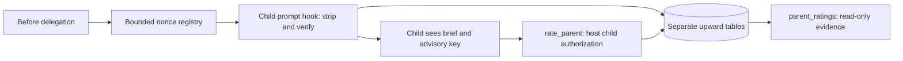

# Design

## Context

Existing downward capture runs after delegation; it cannot bind feedback before child execution. The verified V2 before-tool and pre-admission prompt hooks provide earlier interception points.

## Decisions

**Choose correlated pre-admission binding.** An after-result handshake is simpler but too late. An ancestry-only/context-hook approach cannot distinguish overlapping resumed requests. Instead, `parent-capture.ts` creates a random 256-bit nonce in `execute.before`, recording host parent session, parent agent, message and tool-call IDs, timestamp, and expected resumed child when present. A reserved envelope appended to `input.prompt` carries only that nonce.

The prompt hook removes the envelope before durable child admission, including expired/unknown envelopes. It matches an outstanding nonce, verifies the actual host child's `parentID` equals the captured parent, and checks any expected resumed child. A mismatched resumed session receives no solicitation. Successful binding persists an opaque upward key plus child prompt message ID before adding an advisory first-action request to rate this initial brief, not later work. Repeated hooks for the same nonce/message reuse the binding; different messages cannot consume it. Concurrent/resumed delegations have independent keys. No raw brief is retained by the plugin.

**Choose dedicated tables rather than a direction flag.** Reusing downward tables reduces schema work but risks feeding tuning queries. `parent_calls` holds immutable request identity; `parent_votes` has a unique request key. Submission rechecks host child identity, expiry and lineage, then atomically inserts the vote and marks the request rated. Score/comment validation reuses existing limits. Completion and first-action timing are never checked; delayed submission remains possible through `pendingTtlHours`.

**Choose conservative exclusion.** A local upward lineage walk checks host metadata and known pass sessions through 32 ancestors. Errors, cycles and depth exhaustion mean unknown, hence no capture/submission; this avoids inheriting the existing check's incomplete-walk false result. Both endpoints are checked at binding and submission. Pass containment excludes both upward tools even when allowlisted, keeping evidence out of automatic tuning. Outside containment, the reader has no agent-role restriction; agent-engineer is merely the usual reader.

**Choose fixed bounds over new configuration.** Per-instance nonce capacity is 1,024 with five-minute expiry. Database-wide admission allows 4,096 currently eligible unrated bindings, counted and reserved transactionally; expired records do not consume capacity. Capacity failures omit feedback, not delegation. No bound-child memory cache is needed. `pendingTtlHours` controls voting eligibility only: persisted bindings and votes remain until the existing local database is deleted, with no automatic evidence deletion. Queries use SQL aggregates and bounded recent comments (default 10, maximum 50); no offset or pagination API is added.

## Risks

Hook/storage/identity failures omit feedback and emit sanitized diagnostics without throwing into delegation. Host lookups have one-second deadlines and 128 slots held until settlement; saturation omits feedback. Envelope removal precedes fallible checks. Unload clears nonce state and prevents late writes; persisted bindings survive restart. Admission failures can leave pending orphans that stop consuming admission capacity at expiry but remain stored. Fixed bounds constrain transient state, not retained database history; disk usage grows with history.

Comments are untrusted fields with a fixed warning. Guidance discourages sensitive quotations. README explains database-wide cross-project visibility, shared-local-account access, retention and deletion; owner-only storage is not project isolation. No automatic exports, brief archive, enforcement engine or upward tuner is justified.

## Migration

Additive tables and indexes leave downward queries/state unchanged. Existing database deletion remains the history-removal mechanism; the migration introduces no purge, retention job or historical backfill.
