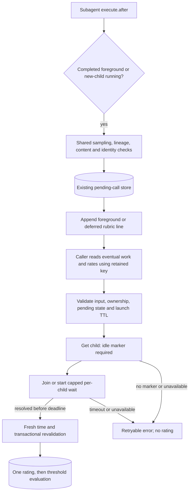

# Design

## Context

See `proposal.md` for the approved scope and accepted limits. Today `createCaptureHook` admits only completed output, resolves the agent, records a pending call and appends `ratingRequestLine`. `rateSubagentTool` immediately calls transactional `Store.submitRating`, then evaluates the quality threshold. `server.ts` owns registration and teardown; `HostPort` isolates host SDK types.

The caller supplied verified OpenCode v2.0.29 facts: a new background launch returns before execution becomes active; `session.wait` can therefore resolve before any work runs. `session.get().time.idle` appears only after an execution ends. Wait has no abort signal and rejects for unknown/deleted sessions. Neither a running/status field nor `session.active` is available. These facts, not inferred event metadata, define the completion check.

The existing `subagent-rating-capture` contract remains authoritative except for the launch solicitation and rating admission delta below. No throughput target or availability SLA is introduced: uncertain child state fails closed for that rating attempt, not for the child or plugin.

## Goals / Non-Goals

**Goals:** Extend the existing capture/store flow with a deferred solicitation, block premature ratings without interrupting children, and bound outstanding non-cancellable waits. Preserve foreground wording, identity, sampling, lineage exclusion and exactly-once storage.

**Non-Goals:** Completion notifications, event subscriptions, polling workers, durable completion tracking, invocation-level completion proofs, resumed-background solicitation, result-read enforcement, schema migrations, new configuration keys or UI. Existing foreground resumed calls remain eligible; the proposal's resumed-child exclusion applies to background launches.

## Decisions

### D1 — Classify once, then share capture safeguards

Admit only `subagent` events with outer status `completed`, usable result content, a string child `output.sessionID`, and a string requested `input.agent`. Classify the output as:

- `completed`: existing foreground path, including foreground calls with an input `sessionID`.
- `running` and no supplied input `sessionID`: new-child background path.
- Anything else: unchanged result, no record. A supplied `sessionID` of any value excludes the running path; malformed continuation input must not be mistaken for a fresh child.

Output status is the authoritative launch classification; `input.background` is not independently required. It describes requested execution, not the returned state. Both admitted paths share deterministic sampling on `event.id`, pass-lineage exclusion, host-resolved agent identity/version at capture, record-before-append ordering and existing catch/log/leave-result-unchanged behaviour. Do not query or wait for the child in capture. Background `createdAt` is launch capture time.

**Alternative:** Separate background capture hook. Rejected: duplicates the safety gates and risks different identity/sampling behaviour. Requiring `background:true` as well adds a redundant gate with no additional completion guarantee.

### D2 — Validate, probe, then transact with fresh time

`rateSubagentTool` receives the session capability through the local port and uses this order:

1. Validate call-key type and score/comment using existing validation rules.
2. Preflight the stored call: exists, owned by this caller, pending and not expired, using a preflight clock reading. No child lookup or wait is allowed before these checks. Expired calls are marked expired as today.
3. Probe the recorded child session, never an input-supplied session.
4. On successful probe, read `now` again and call existing transactional `submitRating`. It rechecks ownership, pending state and expiry, inserts once and marks rated. Evaluate the threshold only on success, using this fresh timestamp.

Expose a small store preflight operation returning the validated call or existing error; share its pending/ownership/expiry checks with transactional submission rather than copying their rules into the tool. Preflight does not reserve the call or hold a transaction across asynchronous host work. Two concurrent submissions may both probe, but only one transaction can store a rating. If TTL expires during the probe, final submission expires/rejects it.

The completion predicate is **`time.idle !== undefined` AND a current `session.wait` resolves within the probe deadline**. Read `session.get` first. A missing idle marker is immediately classified as still running/not yet finished, including the launch-to-active race; do not start a wait in that case. With an idle marker, use the registry in D3 to obtain/join a wait. Do not inspect `outcome`: succeeded, failed and interrupted/cancelled executions are all ratable when idle.

Use named internal constant `CHILD_PROBE_TIMEOUT_MS = 1000`, not a config key. A one-second total deadline covers the get and subsequent wait, so a slow get cannot hang the tool; wait receives only the remaining budget. Timers are local deadlines, not host cancellation. This is a fail-closed responsiveness budget, not a claim that all hosts respond within one second.

| Probe result | Tool response | Persistence |
|---|---|---|
| Missing idle marker, or wait exceeds deadline | `Subagent still running; rate after it finishes.` | No rating; call stays pending |
| Get/wait rejects (including unknown/deleted child), malformed session data, get exceeds deadline, registry full or disposed | `Cannot determine subagent state; retry later.` | No rating; call stays pending |
| Idle marker and wait resolves within deadline | Transactional submission | Existing validation/expiry/exactly-once rules |

Do not leak raw host errors into caller-facing state errors. Expiry handling is separate from probe rejection: a failed probe does not itself expire a previously valid pending call; its next submission is revalidated against TTL.

**Alternatives:** Wait alone is simpler but unsafe in the verified launch race. Idle alone misses an active later execution. Holding a SQLite transaction during host calls extends locks and still cannot make host state atomic with storage. New timeout configuration expands the fail-closed config surface without a present tuning requirement. Recommend the combined bounded probe and existing transaction.

### D3 — One unresolved host wait per child, owned by the rating tool

Create one registry in the rating-tool instance closure, shared by its executions, keyed by child session ID. It holds the underlying unresolved wait promise, not the per-attempt timeout race. Install the entry before yielding so concurrent attempts cannot create duplicate waits. Join an existing entry; otherwise start one. Normalize both resolution and rejection and remove that exact entry only when the underlying wait settles. Never cache a settled success: a later attempt must obtain a current wait, since the child may have resumed.

An attempt timeout clears its local timer but **does not delete the underlying entry**. A retry joins that same unresolved wait with its own deadline. A rejection is handled even after all rating attempts have timed out; settlement cleanup never reads or writes the store.

Set named internal `MAX_IN_FLIGHT_CHILD_WAITS = 128`. At capacity, existing children may still join; new children get the unavailable response. Do not evict unresolved entries, even when their call expires: eviction would permit another non-cancellable wait for the same child. This cap is an operational safety ceiling, not an expected workload size; normal completed foreground waits promptly free their slots. Memory/host waits scale with distinct probed children, capped per plugin instance, not with repeated attempts.

Provide a local dispose operation wired into `server.ts` teardown **before** `store.close()`. Dispose marks the tool closed, wakes outstanding local probe races with unavailable, clears their timers and drops registry references. Check closure state after every asynchronous probe and immediately before submission, so no continuation stores/evaluates after unload. Subsequent executions reject without host work.

Dispose cannot cancel host waits. Their terminal handlers remain harmless until settlement or host shutdown; no new waits start in the disposed instance. Repeated hot reloads can retain waits from old instances until those host calls settle: the cap is per instance, not a process-global guarantee. Restarting the host is the recovery for permanently stuck host waits; do not interrupt children to reclaim slots.

**Alternatives:** Eviction on timeout appears bounded but accumulates hidden host waits. A fresh wait per retry has the same defect. A global scheduler, persistent registry or host cancellation shim is unnecessary infrastructure and cannot provide cancellation the API does not expose. Recommend the small capped instance-local registry and explicit disposal.

### D4 — Deferred wording alongside the unchanged foreground line

Keep `ratingRequestLine(callId)` and its rendered foreground text unchanged. Add a second formatter, `deferredRatingRequestLine(callId)`, in `src/core/rubric.ts`, sharing the anchored rubric text without changing its words or levels. The background line is one appended `[rate]` line:

> [rate] Keep call key "{callId}". After this background subagent finishes, read its eventual result or failure report, then call rate_subagent {call:"{callId}", score:1-5, comment}. Rate that work, not this launch acknowledgement: 1 unusable/redo · 2 major rework · 3 usable with fixes · 4 good, used as-is · 5 excellent. Judge the result against your original brief only. Never invent a call key.

Change the tool description to allow a key from either the finished foreground result or the earlier background launch line. Tell the caller to retain the real key, read the eventual result/failure report and rate only after completion; never invent a key or use the child session ID. Retain the score anchors and comment cap. No additional completion line or automatic rating is produced.

**Alternative:** Change the existing line to a conditional/mode formatter. Rejected: a separate named variant keeps the existing foreground contract explicit while centralizing shared rubric text. This is a small tool-text change, not a non-trivial interface needing a UI-design pass.

### D5 — Extend the local host seam, not capture's dependencies

Add `time?: { readonly idle?: number }` to local `SessionInfo`, and `session.wait({sessionID}): Promise<void>` to `HostPort`. Retain its compile-time real-context assignability check. SDK-branded IDs and any necessary adaptation stay at the port/adapter boundary; introduce no direct host SDK types in `capture.ts` or the probe logic. Capture still needs only agent lookup, not session capabilities. Extend only the rating tool's dependencies, not every read-only tool's requirements, where practical.

The fake host must expose deterministic session state and controllable wait settlement/rejection plus invocation counts. Ordinary idle sessions resolve wait immediately; an explicitly active session leaves it pending; unknown IDs reject. Model “new child, no idle marker, wait would immediately resolve” separately from active execution. Do not derive fake activity solely from presence of `time.idle`: a resumed active child may retain that marker. Fixtures distinguish the caller session from the output child session and set launch input `sessionID` when testing continuations.

**Alternative:** Import the full SDK context into capture/tests. Rejected: couples core capture behaviour to unrelated host capabilities and makes the verified startup race harder to model.

### D6 — One admission rule, existing timestamps and schema

Apply D2 to **all** pending calls. Completed foreground children already have an idle marker and an immediately resolving wait, including completed foreground continuations. There is no foreground/background discriminator in storage. Existing pending records are checked by the same rule; missing/deleted children fail closed.

Keep `createdAt` and `pendingTtlHours` unchanged. For background calls TTL starts at launch, not completion. A job exceeding TTL cannot be rated even if it later finishes. README must explain this, between-turn idle counting as finished, continuation exclusion for background solicitation, result-reading responsibility and ratability of failed/cancelled executions.

**Alternatives / YAGNI rejections:** A completion timestamp and schema discriminator would require migration and expiry redesign for no approved need. Event-based completion needs metadata not guaranteed by the supplied contract and loses state on restart. A result-read token cannot prove the caller judged the work. Do not add these, a poller, a new config key or resumed-background support.

## Primary flow

## Risks / Trade-offs

- **Idle is not invocation completion** → New-background-continuation solicitation is excluded; a child idle between turns still counts as finished. A resume after the wait resolves can race storage. No atomic host/store boundary is promised.
- **False “running” or unavailable responses on slow hosts** → Retry with the same pending key; one-second attempts do not interrupt child execution. A startup child without idle never passes solely because wait resolves immediately.
- **Interrupted infrastructure work can be scored** → Accepted user decision: idle failed/cancelled work is ratable, but the caller must distinguish work quality from host failure in its comment.
- **Stuck non-cancellable waits exhaust capacity** → At most 128 per live instance, no retry accumulation; other capture/read-only tools and child work remain unaffected. Settlement releases capacity; permanent hangs require host recovery. Unload cannot promise host-side cancellation.
- **Concurrent submit / expiry during wait** → Preflight is advisory; synchronous transactional revalidation remains authoritative. No rating, threshold evaluation or pass launch occurs on rejection.
- **Restart loses registry, not pending keys** → Durable calls remain in SQLite and can be re-probed after reload while TTL permits. No recovery worker or new storage is required.
- **Caller rates acknowledgement or loses key** → Explicit deferred line and tool description; reading the result remains a caller obligation, not a property the probe enforces.

## Migration Plan

No database/config migration. Deploy through the existing build/plugin-loading process; the store schema is unchanged. Rollback restores foreground-only solicitation; existing pending launch records then expire under the same TTL. Do not promise that rollback's old rating tool retains the new completion guard.

## Behavioural requirement mapping hints

For the engineer to transcribe into delta specs (this document does not edit specs):

- **D1 → Rating request injection / exclusions / server-side identity:** replace the blanket background exclusion with new-child launch solicitation; preserve foreground continuations, call-key sampling and lineage gates; reject background continuations and malformed/unrelated events.
- **D2, D6 → Validated rating / expiry:** no host probe for invalid, foreign, rated or expired keys; both completion signals required; failed/cancelled idle children accepted; distinct retryable running/unavailable errors; final fresh-time expiry and exactly-once transaction.
- **D3 → Bounded probing:** repeated/concurrent attempts share one unresolved wait per child, timeout retains it, settle cleans it, capacity rejects new waits without eviction, unload prevents late storage.
- **D4 → Solicitation and tool guidance:** preserve foreground line, deferred real key and eventual-work instruction, no invented keys or session-ID substitution.
- **D5 → Host-contract tests:** startup-window idle absence, stale idle while active, wait timeout/rejection/deletion, unload and foreground compatibility use verified host semantics.
- **D6 → Documented limits:** launch-based TTL, idle-between-turns, no proof of reading and no resumed-background solicitation; no schema/config changes.

## Component breakdown

| Part | Work kind | Done criterion |
|---|---|---|
| Capture classification and rubric formatters | Application code | New-child background launches get one deferred line and pending record; shared safety gates and foreground text are preserved. |
| Rating admission and store preflight | Application code | Invalid/foreign/expired keys never probe; finished-child predicate precedes fresh-time transactional submission; rejected probes never store/evaluate. |
| Wait registry and teardown wiring | Application code | Sharing, cap, timeout retention, settlement cleanup and unload safety are observable in deterministic tests. |
| HostPort and fake host | Application code / tests | Real-context type check holds; fake models idle, active, startup race, rejection and controlled settlement independently. |
| Behaviour/README coverage | Documentation / tests | Requirement mapping and accepted limits are represented; foreground regression, concurrency and TTL-crossing cases pass. |

## Research and method notes

Loaded `design-agent-common`, `documentation`, `coding` and `opencode`; used the supplied approved structure and OpenSpec design guidance. Mapped the seven commissioned source files with symbolic navigation and direct reads, read the current touched spec, and checked prior memory (including the known call-key/session-ID distinction). No live diagnosis, additional domain research, implementation, tests or git operations are needed for this design-only commission. All changing host API facts above were supplied as verified by the caller; none require a new lookup. No unresolved design questions remain. Durable findings are kept here rather than written to memory because the commission permits only this file mutation.
