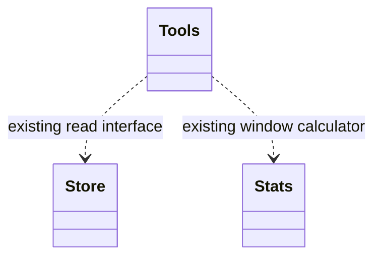

# Design

## Context

See [proposal](proposal.md) for scope and the delta spec's [Evidence query tool requirement](specs/subagent-rating-analysis/spec.md#requirement-evidence-query-tool) for the field contract and population semantics.

## Decisions

### One read, bounded window input

Use one full read through existing `recentRatings` with `Number.MAX_SAFE_INTEGER`. Slice the first 500 raw rows before calling existing `windowStats`, preserving the existing scan-before-filter behavior.

Alternative: separate bounded and full-history reads. This duplicates retrieval and can mix rating snapshots. One read plus slicing is simpler and keeps both calculations on the same retrieved evidence.

### Shared calculation; additive output

A private helper in `tools.ts` owns retrieval and summary calculation for overview and detail, avoiding duplicated filtering and arithmetic. Existing `windowStats` remains the window calculator rather than introducing another implementation.

Prefer nested `window` and `lifetime` summaries using `n` and `mean`, extending the existing detail convention. Flat or mode-specific names save nesting but introduce inconsistent vocabulary. Exact serialization belongs to the linked requirement.

## Risks / Trade-offs

Accept O(N) history-read and memory cost per agent, accumulated across agents in overview. Store-side aggregation could reduce memory but expands the excluded storage interface. README and the tool description communicate the accepted cost. Read errors propagate instead of producing partial summaries; no recovery mutation or data migration is introduced.
