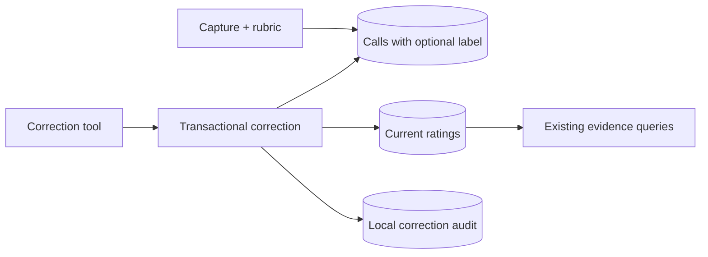

# Design

## Context

Opaque call keys make misattributed feedback difficult to notice and recover from. This change extends the existing capture → SQLite → evidence path, within the proposal's session-owned correction scope. Parent feedback, dependencies, and tuning lifecycle remain outside the delta. Existing capture, analysis, and containment contracts provide the domain boundaries.

## Decisions and alternatives

### Recognizable targets

Persist an optional, normalized task label on `calls`, derived only from `input.description`; agent identity continues to come from host resolution. Prefer this over reconstructing labels from child history: persistence survives restarts without extra host queries or brief/output exposure. Legacy rows retain an absent-label fallback.

Keep normalization and target formatting in `core/rubric.ts`, shared by capture solicitations and tool acknowledgements. A named 200-character cap, whitespace/control-character normalization, and JSON string escaping produce bounded single-line presentation. Labels remain untrusted descriptive data, not identity. Acknowledgements combine the stored target with the accepted score; public evidence retains its existing fields.

### Correction boundary

Prefer a separate `correct_subagent_rating` tool over extending `rate_subagent`: initial admission keeps its existing input, child probe, expiry handling, and evaluation path. The correction input uses `call` and an `edit`/`retract` action; edits carry a complete score/comment pair, avoiding partial-update semantics. Retraction carries no replacement vote.

A dedicated repository operation owns lookup, recorded-caller ownership, current-vote lookup, validation via `validateRating`, and mutation. It deliberately bypasses pending-rating preflight: that preflight encodes admission expiry, not correction eligibility. Tool construction uses only storage, configuration, and clock dependencies, excluding child probing and threshold callbacks.

### Current evidence plus audit

Prefer in-place current-vote updates plus an append-only `rating_corrections` table over event-sourced evidence reconstruction. Existing evidence queries continue reading `ratings`, avoiding new joins and changes to version/window selection.

Audit rows contain an independent sequence id, call reference, actor session, action, correction timestamp, original rating id/type/version/timestamp, and before/after score/comment values; retractions have null after-values. Referencing the call rather than the deleted rating keeps retraction history intact. Audit remains local, without a query API.

Use the existing driver transaction around authorization, audit insertion, and mutation. Edits update only score/comment, preserving rating id and ordering. Retraction deletes the vote and returns the call to pending without touching capture time; any later initial submission follows ordinary admission. Correction neither replays nor reverses tuning decisions.

Append one migration using the existing transactional `user_version` sequence: nullable label column plus audit table. Reopening an upgraded database skips completed migration work; existing votes remain intact.

## Flow

## Resilience and operations

Transaction rollback prevents split audit/evidence state; immediate transactions serialize competing corrections. Missing or foreign votes fail without mutation. Storage failures surface as tool errors. Correction eligibility is independent of age, version, and resolution. Existing passes/state can intentionally disagree with corrected evidence; recovery remains explicit human resolution, not automatic rollback.

Register the tool through the existing server path and add it to `NEVER_IN_PASS`, reusing fail-closed ancestry containment. No parallel containment mechanism is needed. Audit storage grows with corrections; evidence-query scaling stays unchanged. Event replay, history APIs, reassignment, and background reconciliation are rejected as unnecessary scope.

## Component breakdown

| Part | Work kind | Done criterion |
|---|---|---|
| Rubric/capture | Application code | Stable, bounded stored targets |
| Store/migration | Application code | Atomic corrections with durable audit |
| Tools/server/containment | Application code | Isolated correction route, pass exclusion |
| Existing tests/README | Tests/documentation | Correction boundaries verified and explained |
